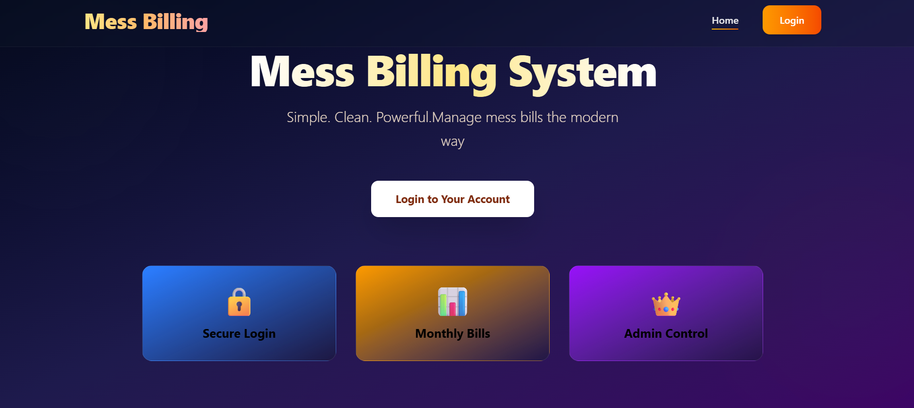
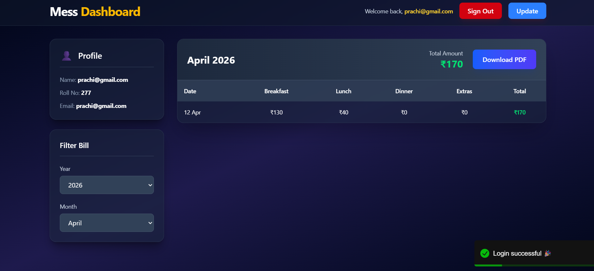
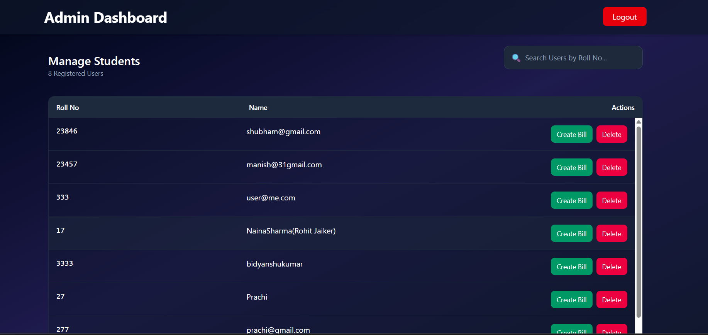
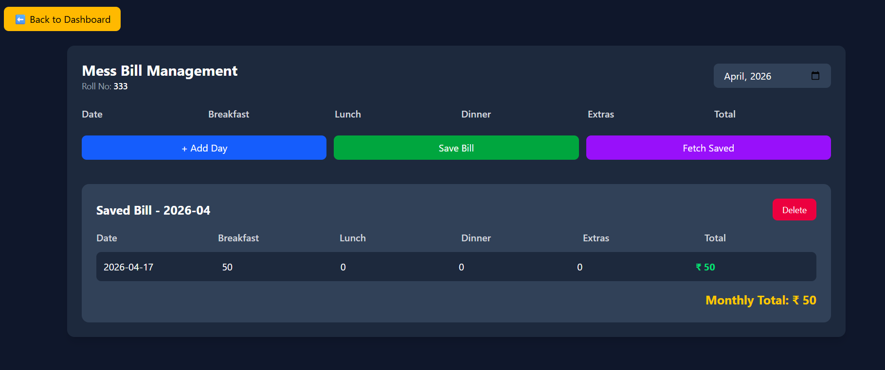

# 🍽️ MealLedger
### Smart, Transparent & Automated Meal Management

A modern solution to simplify and automate mess billing operations. MealLedger eliminates manual calculations, reduces errors, and provides a seamless way to track meals and generate accurate bills for users.

## 🌟 Overview

Managing mess bills manually is time-consuming and prone to mistakes. **MealLedger** is designed to digitize this process by tracking daily meal consumption and generating precise monthly bills with minimal effort.

Whether it's a hostel, PG, or college mess, MealLedger ensures efficiency, transparency, and reliability.

## ✨ Key Features

- 🧾 **Automated Billing System** – Calculates monthly bills instantly.
- 📅 **Daily Meal Logging** – Track Breakfast, Lunch, and Dinner.
- 👥 **User Management** – Maintain individual user records.
- 📊 **Monthly Reports** – Detailed breakdown of meal consumption.
- 💡 **Error-Free Calculations** – Eliminates manual mistakes.
- ⚡ **Fast & Intuitive Interface**

## 🧠 How It Works

1. Users are registered in the system.
2. Daily meal data is recorded.
3. Each meal has a fixed cost.
4. At the end of the billing cycle:
   - Total meals are counted.
   - Final bill is calculated automatically.
   - Summary is generated.

## 🛠️ Tech Stack

| Layer | Technology Used |
|---|---|
| Frontend | React.js, Vite, Tailwind CSS |
| Backend | Node.js, Express.js |
| Database | MongoDB, Mongoose |
| Authentication | JWT, bcryptjs |
| Real-Time Communication | Socket.IO |
| Tools | Git, GitHub, VS Code |

## 📁 Project Structure

```text
MealLedger/
│
├── client/             # Frontend application
├── server/             # Backend application
├── README.md
└── ...
```

## ⚙️ Installation & Setup

### Clone the Repository

```bash
git clone https://github.com/bidyanshu-20/MESS_BILLING.git
```

### Navigate to Project Directory

```bash
cd MESS_BILLING
```

### Install Dependencies

Install dependencies in both the client and server directories.

### Run the Application

Start the frontend and backend development servers.

## 🌐 Live Demo

**Live Hosted Application:**  
https://mess-billing.vercel.app/

## 📸 Screenshots

### MealLedger – Main Interface


### User Dashboard


### Admin Panel


### Billing Dashboard



